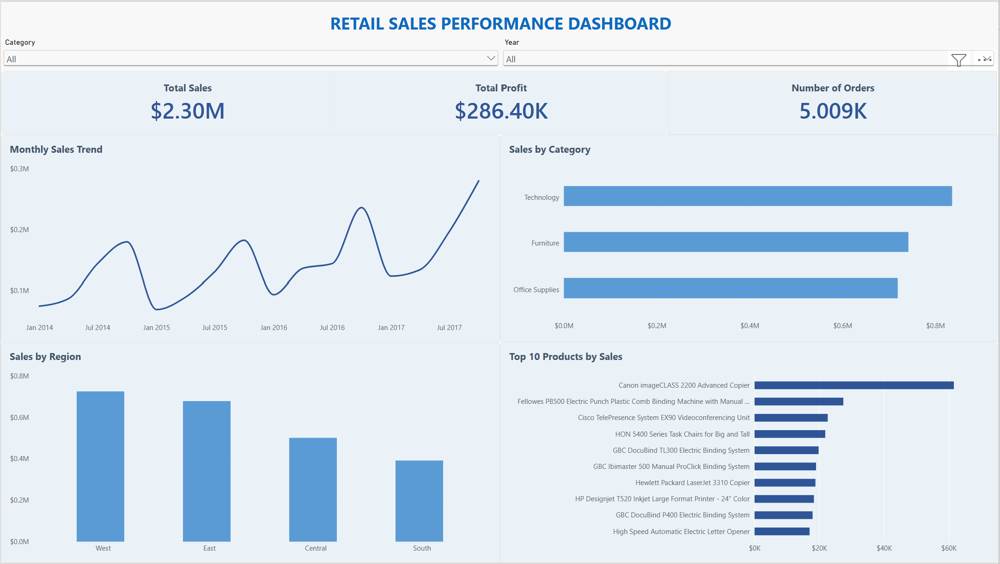

# Retail Sales Performance Dashboard

## Project Overview

An interactive Power BI dashboard built to analyse retail sales and profitability. This project demonstrates data preparation, KPI reporting, data visualisation, and interactive business reporting.

## Dashboard Preview

## Business Questions

- How do sales change over time?
- Which product categories generate the highest sales?
- How does sales performance vary across regions?
- Which 10 products have the highest sales?
- How can users explore performance by year and category?

## Key Performance Indicators

- **Total Sales** — overall sales revenue.
- **Total Profit** — overall profit.
- **Number of Orders** — distinct order count.

## Dashboard Features

- Monthly sales trend analysis.
- Sales comparison by product category.
- Regional sales performance comparison.
- Top 10 products ranked by sales.
- Interactive Year and Category slicers.
- Consistent KPI formatting and business-focused visualisation.

## Tools and Skills

- **Power BI Desktop:** dashboard development and visualisation.
- **Power Query:** data preparation and data type validation.
- **Data Analysis:** sales, profit, order and product performance.
- **Business Intelligence:** interactive reporting and KPI analysis.

## Key Insights and Recommendations

Insights and recommendations should be documented after reviewing the actual dashboard results, including sales trends, category performance, regional differences, and product profitability.

## Project Objective

To demonstrate practical data analytics and business intelligence skills relevant to Junior Data Analyst roles.
